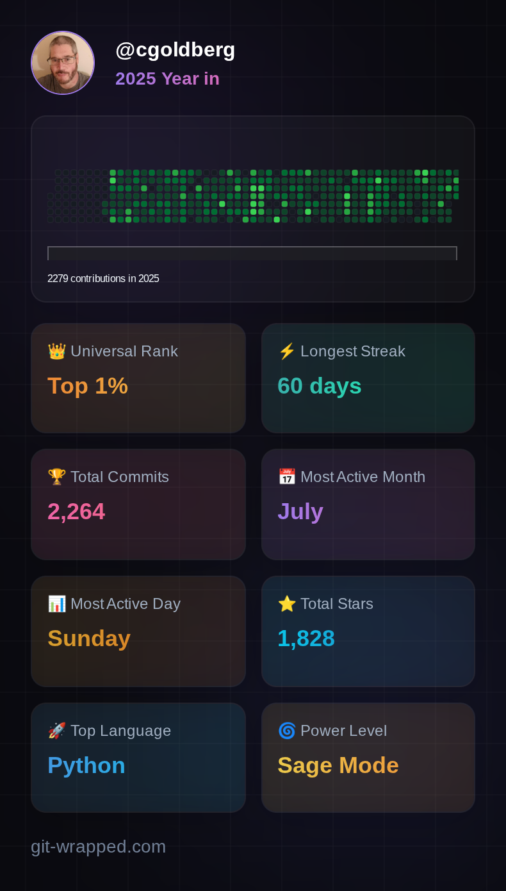

It's New Years Eve...

It was a busy year working on many open source projects. I did a lot of
programming in 2025:

**2,279** contributions in **69** public repositories:
[github.com/cgoldberg](https://github.com/cgoldberg)

(that is addition to my full-time job writing more code!)

